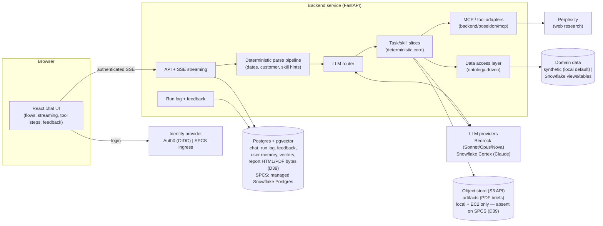

# 00 — System Overview

Status: Draft for review · Date: 2026-07-28 · Scope: full overhaul of Poseidon

## 1. What Poseidon becomes

Poseidon is rebuilt as a **chat-first sales-intelligence application** for marine fuel sales: a
general **ask-anything surface** over internal data plus external research — not a report app of
any fixed shape. A ChatGPT-style React interface replaces the Streamlit dashboard. Behind the
chat sits a **deterministic core**: Python functions do all data access, math, and formatting;
the LLM acts only as a **router/orchestrator** that selects skills and fills validated arguments
(the TM1-Finance-Agent-V2 philosophy).

### The three conversation flows

| Flow | Entry | What happens |
|------|-------|--------------|
| **Default chat** (no bubble) | free text; optional preset-skills picker | Conversational Q&A over the ontology-backed data skills — "what are my top GP customers for Port of Singapore in April 2026" returns data. Follow-ups can pivot to external research on a returned entity ("any relevant news on customer X I should be aware of?"), which invokes the web-research skill (Perplexity, marine-industry lens) like today's researcher agent. |
| **New Customer Prospect** (bubble) | company name | Today's prospect research flow produces the brief; the user can then pivot into internal data (e.g., which existing customers we already serve at a port named in the brief). |
| **Existing Customer** (bubble) | customer picker | Today's analytics suite runs and produces the brief; the user can then drill into internal detail (ports, lanes, metrics) and ask real-time external questions answered via Perplexity. |

**Design rule:** the chosen flow shapes the **entry orchestration only**. After the initial
deliverable, the full skill registry — internal data skills and research skills — is available
to the router in every flow, with carry-over context (active customer, port, period) maintained
by the deterministic conversation-state layer (doc 02 §5).

## 2. Goals

1. Conversational data Q&A over the certified ontology is a **core capability**, live in every
   flow — with web research (Perplexity, marine-industry lens) as its counterpart.
2. Preserve today's two agent flows (Contextualizer → Researcher → Strategist) end to end, as
   the entry orchestration of the two bubbles.
3. Chat UX with per-user history: list, reopen, continue, and start conversations.
4. Deterministic skill framework: every task is a self-contained directory of skills/tools.
5. Deterministic pre-parsing (dates, customer names, skill hints) before any LLM call.
6. Config-driven LLM tiering across **AWS Bedrock and Snowflake Cortex** behind one provider
   interface: Sonnet router, optional Opus supervisor, cheap tiers for grunt work.
7. Identity flow-through: verified identity propagates to every query (row-level security), chat
   persistence, and personalization — populated by Auth0 or SPCS ingress (doc 05).
8. Per-user personalization: a user system instruction and a distilled memory document, injected
   into router/synthesis prompts and editable by the user (docs 01/05).
9. Feedback capture on every assistant message, linked to the run log and harvested into the
   router-decision test pipeline (doc 06).
10. Observability from day one: the run log records every turn as a parent row plus one row per
    model call and tool call; router-decision tests are a first-class, in-repo test category.
11. Local-first: the entire system runs locally (docker-compose, synthetic data adapter — the
    standard local-development practice) and deploys as one container to **EC2 (first-deployed)**
    and **SPCS (the corporate primary target, deployed after)** -- decision D8 as revised
    2026-08-05; **Snowflake** is the production data platform.

## 3. Non-goals (this overhaul)

- No microservices. One modular backend service (modular monolith).
- No free-form LLM-generated SQL. All queries derive from the certified ontology (a guarded,
  additive text-to-SQL skill is a documented future path, doc 04 §7 — never a replacement).
- No fixed report product. mom-comparison contributes conversational mechanics (carry-over,
  validation, exact-value pass-through) — not its comparison-report product shape.
- No self-healing loop. Feedback is captured, stored, and harvested into tests; automatically
  acting on it is explicitly future work (doc 06 §7).

## 4. Architectural principles

| # | Principle | Consequence |
|---|-----------|-------------|
| P1 | LLM routes, Python computes | The model's only output surface is `(tool_name, args)` plus narrative prose. All numbers come from deterministic code. |
| P2 | Vertical slices | Code is organized by business capability (`tasks/<task>/skills/<skill>/`), not by technical layer. |
| P3 | Ontology as single source of truth | Schemas, metrics, guardrails, and synthetic data all derive from the certified `ontology.yml` semantic layer. |
| P4 | Zero trust at every gate | Identity verified at the edge (JWT signature, or the platform-injected SPCS ingress identity); LLM tool arguments validated by schema; dimension values whitelisted before touching SQL. |
| P5 | Presentation isolated from logic | The React UI renders typed message parts through a renderer registry and theme tokens; a restyle never touches business logic. |
| P6 | Evidence by construction | Every turn writes a run-log parent row plus one row per model and tool call; every skill returns a deterministic proof block; tests live in the repo and run from day one. |
| P7 | Config over code | Model tiers and providers, prompts, data backend, identity mode, and deploy target are configuration, swappable per environment. |

## 5. System context



## 6. Repository layout (target)

```
poseidon/
  frontend/            # React + TypeScript chat application (doc 01)
  backend/
    api/               # FastAPI routes, SSE, request middleware
    core/              # config, identity providers, db, structured logging, LLM providers
    chat/              # turn pipeline: parse -> route -> execute -> stream
    tasks/             # vertical slices: task -> skills -> tools/subskills (doc 02)
    mcp/               # external tool-server registry: mcp/<server>/ (doc 02 §7)
    observability/     # run-log writer, replay, token accounting, feedback (doc 06)
    tests/             # cross-cutting tests; skill tests live inside each skill
  ontology/            # certified ontology.yml + synthetic data profiles (doc 04)
  config/              # models.yml, env schema, prompt registry root (doc 03)
  infra/               # docker-compose, deploy scripts, runbooks (doc 07)
  docs/architecture/   # these documents
```

## 7. Provenance — what each source system contributes

| Source | Carried forward | Deliberately changed |
|--------|-----------------|----------------------|
| `latest_poseidon` (current app) | Both agent flows, agent prompts, Perplexity research schemas (marine-industry lens), metric definitions and period logic, PDF brief export, Auth0 role `Poseidon:Sales`, Cortex `claude-sonnet-4-5` usage | Streamlit UI replaced by React chat; Cortex retained as a first-class provider **alongside Bedrock** behind one interface; JWT now signature-verified; SQL now built from the ontology, parameterized |
| `mom-comparison` | Date carry-over semantics, period validation against available months, exact-value pass-through between turns, identifier-correction guardrails, "LLM narrates, pandas computes" — the conversational mechanics only, not the comparison-report product shape | Extraction moves from LLM-emitted sentinel blocks to deterministic Python pre-parsing; sentinel substring dispatch replaced by native tool calling |
| `TM1-Finance-Agent-V2` | Tool-schema registry pattern, provider router with normalized `ToolCall`/`LLMResponse`, conversation-buffer carry semantics, snapshot/property/stub-router test patterns, proof blocks, dual data backends behind one tool surface | Tests move into the repo (not gitignored); prompts move from inline constants to versioned config; a run-log table is written on every turn |
| `wfs_work_structure` | `ontology.yml` as the certified semantic layer: entities, metrics with exact SQL, negative constraints, business rules, per-app bindings; the proven **SPCS deployment pattern** (image repo + compute pool + service spec, `DEPLOY_MODE` session strategy, in-service state DB on a mounted volume, Cortex default in-platform, Auth0 `require_claims` gating) | The app consumes the ontology programmatically (loader) instead of hand-copying field dictionaries into code; app state is Postgres (RLS + pgvector), not SQLite |

## 8. Key decisions (summary; details in the numbered docs)

- D1 Backend is Python/FastAPI, one modular monolith — reuses the team's Python skill and TM1
  patterns; no microservices overhead.
- D2 The LLM router uses native function calling with schemas generated from Pydantic models —
  eliminates sentinel-string dispatch fragility observed in mom-comparison.
- D3 Subskills are orchestrated deterministically by their parent skill; the router never sees
  them — keeps the three-agent sequence stable and testable.
- D4 The data layer is an adapter interface (`DataClient`) with synthetic and Snowflake
  implementations selected by config — the whole app runs locally and the backend swaps later.
- D5 Postgres row-level security enforces per-user chat isolation in the database, not only in
  application code.
- D6 Tests, including router-decision tests, are committed to the repo and runnable from day one —
  explicit reversal of the TM1 gitignore practice, per project feedback.
- D7 Streaming uses Server-Sent Events, not WebSockets — unidirectional token/phase streaming is
  all the chat needs; simpler to operate behind a proxy.
- D8 (revised 2026-08-05) One container image, two deploy targets sharing one
  environment contract. **EC2 deploys first** (owner decision at Phase 13 closure: get a
  public, Auth0-gated instance live on proven AWS footing before the corporate-platform
  work); **SPCS remains the corporate primary target**, deployed after, with the
  Snowflake data backend onlined by a separate Snowflake-side effort. Dev/prod parity
  over premature scale-out, unchanged.
- D19 Flow = entry orchestration only; after the initial deliverable the router sees the full
  skill registry in every flow — pivots are the product, not an exception (doc 02 §4).
- D20 **(SPCS half revised by D39 — see below)** App state (chat, run log, feedback, user
  memory) is Postgres everywhere, keeping the RLS/pgvector schema identical across habitats
  (doc 07 §4). The original in-service-container-on-a-block-volume shape for SPCS is superseded:
  SPCS now uses managed Snowflake Postgres. The "Postgres everywhere, one schema" half stands.
- D21 LLM provider layer supports Bedrock and Snowflake Cortex behind one config-driven
  role→{provider, model} interface; SPCS-mode default is Cortex — zero external credentials
  in-platform, and the current app already runs Cortex `claude-sonnet-4-5` (doc 03 §1).
- D22 Identity is an abstraction (`auth0` | `spcs_ingress` | `disabled`) populating one
  `UserContext`; SPCS-mode default is SPCS ingress identity — the platform already
  authenticates Snowflake users, so a second login adds friction without gain (doc 05 §2).
- D23 Web research reaches Perplexity through a first-class MCP/tool-adapter layer; the direct
  API adapter is the default transport — it is the proven in-house path with schema-pinned
  structured output (doc 02 §7).
- D24 (superseded by D31) The per-user memory document is distilled at end of conversation
  (async, debounced) by a config-driven Sonnet tier (doc 05 §5).
- D25 Feedback (thumbs + comment) is stored linked to message and `turn_run` row and harvested
  into the router-decision suite; acting on it automatically is out of scope (doc 06 §7).
- D26 Every SSE event carries a `turn_id`/`message_id`/`event_seq` envelope and an `id:` line, and
  turn creation is idempotent via a client-generated `client_turn_key` — replay and crash recovery
  need every event to be self-addressed (doc 01 §5).
- D27 The run log is `turn_run` + append-only `llm_calls` and `tool_calls`, not one row per turn —
  a turn is N model calls, and only per-call rows can attribute cost and latency (doc 06 §1).
- D28 RLS context is transaction-scoped `set_config('app.user_sub', :sub, true)`, policies read it
  with `missing_ok`, owned tables `FORCE ROW LEVEL SECURITY` — a pooled connection must never
  inherit the previous user's context (doc 05 §4).
- D29 Retention windows are configuration with stated defaults; deleting a conversation
  hard-deletes its content and retains a redacted audit row — the right to delete and the audit
  obligation are both satisfied only by redaction (doc 05 §7).
- D30 Web-research calls carry entity names only, never internal metric values — the one call that
  leaves the boundary must not carry anything computed from the certified views (doc 05 §7).
- D31 (revises D24) Memory distillation is a durable outbox job fired after an explicit idle
  threshold with retries, storing typed attributed entries rendered to markdown at assembly and
  never derived from tool output — an in-process debounce loses work on restart, and free-text
  accumulation from external text is a poisoning vector (doc 05 §5).
- D32 **(scope narrowed by D39)** Every habitat's app state gets scheduled logical backups
  shipped off-store, a rehearsed restore, and stated RPO/RTO. The original wording covered
  in-service Postgres and MinIO containers on mounted volumes; under D39 SPCS has neither, so
  there the obligation is to verify and document Snowflake Postgres's own backup/PITR guarantees
  rather than to run backup sidecars. The rehearsed-restore and stated-RPO/RTO requirements are
  unchanged, and still apply in full to EC2's RDS + S3 (doc 07 §4).
- D33 **(timing revised by D40, interface unchanged)** Phase 5 ships Bedrock + stub; Cortex
  arrives with a provider-parity contract test — prove the seam with one live provider before
  paying for two (doc 03 §1, doc 08). D40 moves Cortex earlier than "the SPCS phase's
  preparation" and fixes its transport; the one-interface, parity-tested requirement stands. **(Cortex availability revised by D68)** **(transport: D79)**

### Monthly performance reports (D34–D45)

Decisions D34–D45 were taken in the monthly-performance-reports design and are recorded here
so this log stays the single index of architectural decisions. Detail, schemas and rationale
live in `docs/superpowers/specs/2026-09-04-monthly-performance-reports-design.md`; that file
remains authoritative for the feature, this table for the fact that the decision exists.

| # | Decision | Revises |
|---|----------|---------|
| D34 | A report is deterministic skill output: Python queries, computes and renders every figure; the synthesis model only writes prose over the computed JSON, and a grounding check verifies every number it writes. | — |
| D35 | Report scope is an office slice (`CUSTOMER_TEAM_NAME` or `PRIMARY_SUPPLY_TEAM_OFFICE`), or the whole book. A definition = office column + office value + recipient list; generate → preview → send, on demand. | — |
| D36 | Comparison basis is an enum with one implemented value, `prior_month`. Other bases are declared but fail validation until built. | — |
| D37 | Report definitions, runs and sends are shared org documents granted to the app role, no per-user row policies. Writes gated by a new role `Poseidon:ReportAdmin`; reads by `Poseidon:Sales`. | — |
| D38 | One `Mailer` interface. Microsoft Graph is the production transport on SPCS (its egress allows only ports 22, 80, 443, 1024+); SMTP serves local Mailpit and EC2; a stub serves tests. The mail path is a new egress processor: report content to allow-listed internal domains, never conversation content. | — |
| **D39** | **On SPCS the app database is managed Snowflake Postgres, injected as `DATABASE_URL` from a Snowflake secret. Report HTML and PDF are stored as bytes in Postgres and served through the API in every habitat; MinIO is not part of the SPCS service.** (refined by D65: report PDF/HTML are served by the Next.js routes `/api/reports/[runId]/{pdf,html}`) | **D20** |
| D40 | `CortexProvider` is built now, over the Cortex REST Messages endpoint with native tool calling — not the SQL `COMPLETE` function with emulated tools. **(timing revised by D68)** **(endpoint named by D79: the Anthropic-compatible Messages endpoint)** | D33 (timing) |
| D41 | Report chat carries the office filter and month pair by default. Scope is an explicit validated skill argument; the model chooses the value, code applies the filter. Share-of-total is computed in Python. The report's figures reach the model only through `reporting.report_lookup`. | — |
| D42 | The EC2 deployment (Phase 14) is paused after its completed offline half; report work sequences first. | doc 08 order |
| D43 | Report content and math follow mom-comparison exactly where it already works: two single-month frames merged in Python, its KPI, top-mover, driver and new/lost rules, its narrative templates. | — |
| D44 | Visibility: the whole book is visible to every Sales user, including other offices' customer-level GP and margin, as in mom-comparison today. Recorded so a later per-office restriction is a conscious change, not drift. | — |
| D45 | The query builder gains a multi-column frame query (several certified columns plus a month/quarter/year bucket, no row limit). A report is four to six queries, and the chat can answer "by port by month". | — |
| D46 | Prompts live in one canonical top-level `prompts/` tree with XML system prompts; skills resolve them by id. Documented exception to the co-location folder law. (refined by Phase 17 A1: the tree lives at `backend/prompts/` because that is the runtime root in every habitat; loader `PromptTree`) | folder law |
| D47 | Ad-hoc in-chat report generation is open to every `Poseidon:Sales` user; `ReportAdmin` gates only shared definitions, runs and sends, enforced at dispatch. | — |
| D48 | A definition's scope is immutable once it has runs; changing office requires a new definition. | — |
| D49 | A report link opens the run it names, marked superseded when newer exists; the grounded chat is scoped to the run the panel shows. | D-chat-follows-current |
| D50 | Saved and emailed reports are complete-month only; day-matched partial months are ad-hoc chat only, outside parity scope. | — |
| D51 | The reconciliation baseline runs mom-comparison with the same row filter, so parity tests the maths. | — |
| D52 | Ranked tables carry an `Other (N)` row so the column sums to the footer. | — |
| D53 | `report_lookup` takes explicit `limit`/`offset` with a remaining-rows marker; no silent truncation. | — |
| D54 | All queries in a report run share one snapshot where supported; otherwise drift is detected and the run retries once. | — |
| D55 | Phase 15 simplified the spec's Phase 15 row: no Auth.js (after M5 production identity is the SPCS header and local is the fixed dev user; identity resolves in Next 16's `proxy.ts`); Drizzle READS the live schema by introspection only, Alembic remains migration authority until roles/grants/policies are ported deliberately (Phase 16). | — |
| D56 | `IDENTITY_EMAIL_SOURCE` (`entra` \| `snowflake_proc`) + `SNOWFLAKE_EMAIL_PROC` exist in both runtimes as a PLACEHOLDER seam for resolving a user's email via a Snowflake stored procedure; the procedure path raises until the procedure code lands; not wired into the identity providers. | — |
| D57 | Phase 16 keeps turn orchestration in Python behind the internal contract; Next.js owns transport, client and rendering (bridge). Revises migration spec §3's orchestration and agent-loop rows; the `contracts/turns` corpus is the entry point for a later port. AI SDK pinned to the 6.x line (`ai@6.0.286`). Consequence: `web/next.config.ts`'s `/api/*` rewrite must be `fallback`, not an array — Next checks afterFiles rewrites before dynamic routes, so an array swallows `/api/chat/[cid]` before the handler ever runs (ruling P16-R19). | revises M1's "AI SDK 6" reading and spec §3 |
| D58 | Drizzle is the migration authority for application tables (Q3 applied): `web/drizzle/0000_roles`, `0001_baseline`, `0002_grants_force_rls` re-derived from Alembic 0003–0010. Alembic no longer runs at boot; 0001–0010 are frozen history; the `synthetic` schema (0002) is created by the seed path. Tripwires: `web/src/db/migrations.test.ts` and the pg suite against a Drizzle-only database. | — |
| D59 | The internal contract is authenticated by a shared secret (`POSEIDON_INTERNAL_TOKEN`, header `X-Poseidon-Internal-Token`, constant-time compare, 503 when unset) and hidden from OpenAPI. The web tier requires `Poseidon:Sales` in the proxy (403) and in every page/handler. | closes R25, P16-4 |
| D60 | The deterministic parser reads a port after the cues "port of", "at" and "in", including a lowercase name. The new paths (the "in" cue and any lowercase name) run in strict mode: only an exact or word-set match applies; a fuzzy match asks "did you mean". A port clarification reuses the `customer_ambiguous`/`customer_unknown` codes, told apart by `ParseIssue.kind == "port"`; the orchestrator sends port chips (`Port of <port>`) or a text-only "which port?" question (P16-R23). | revises `parsing/pipeline.py`'s docstring claim that a weak-cue miss emits no issue |
| D61 | Phase 17 ships as four PRs: C03 fix, report in chat, metric_query extensions, providers. All eleven router cases of the reports design §7.6 are in scope across PRs A and B. (`2026-10-12-phase-17-report-in-chat-design.md`) | migration design §10 row 17 (adds the split) |
| D62 | `ConversationSlots` carries full period windows through two additive fields, `period_a_end` and `period_b_end`. The comparison (`period_b`) is carried until replaced: a single named period replaces A and clears B; a named comparison replaces both; a comparison-only phrase replaces B and keeps A. Orientation: slot A is the period being asked about, slot B is what it is compared to; a report seeds A = report month, B = prior month. | period parser's "B is never carried" contract; pipeline's "B clears every turn" rule |
| D63 | Report perspective is an explicit enum `customer \| supplier \| book`. It alone decides the office column (`CUSTOMER_TEAM_NAME` / `PRIMARY_SUPPLY_TEAM_OFFICE` / none) and the primary entity (`CUST_NM` / `SUPPLIER_NM` / `CUST_NM`). Supplier figures are our certified sales GP on deals that supplier supplied. The customer breakdown of a supplier report is a chat follow-up over pass-through, not a table in the report. | completes the deferred supplier-perspective requirement |
| D64 | Month to date exists only when asked for in words ("month to date", "mtd", "so far this month") or by naming the running month. Chips never offer it. It is chat-only; the payload records `window_kind: complete \| mtd` so Phase 18 refuses to save or email the latter. **(recognition refined by D71)** | refines D50 for ad-hoc chat |
| D65 | `report_run` lands in Phase 17 as Drizzle migration `0003`, shaped for Phase 18 (nullable definition and superseded-by columns). It is a shared org document (no row policy, app-role grants). Report bytes are served by Next.js route handlers reading Postgres behind the Sales-role check, linked from a plain anchor. | resolves C07 and the downgraded C08 for this phase |
| D66 | Charts are deferred to Phase 18. The payload has no `charts` key in `payload_version: 1`; adding it is additive. | reports design §4.9 timing |
| D67 | The grounding check is entity-scoped: each numeric token in a sentence must match a display string belonging to an entity named in that sentence (or a KPI / period-level figure when the sentence names none). The suite carries a must-reject fixture. (refined by Phase 17 A1: scope is the sentence plus earlier sentences of the same paragraph, indented sub-bullets stay in the parent item, KPI and footer figures are in scope for every sentence, and rows keyed Other/Total never alias their first word) | resolves C09 |
| D68 | Three live provider profiles: `bedrock` (unchanged), `anthropic` (new, Messages API over the existing HTTP client, no new SDK), `cortex` (REST Messages endpoint with native tool calling, built offline against recorded fixtures). One provider-parity contract test runs against all three plus the stub. Cortex's live proof is a handoff to the Snowflake-side owner. | D33's "Cortex not before SPCS"; D40's timing (was Phase 19) |
| D69 | An ad-hoc in-chat run, including its PDF, is readable by any `Poseidon:Sales` user. | follows D37, D44, D47 |
| D70 | Internal skills — `SKILL_META['internal'] = True` registers a skill that `skill_ids`, `get` and `dispatch` see but `tool_schemas`, the router prompt, `/api/skills` and the unknown-skill error text omit; dispatched by deterministic flows only. First: `reporting.monthly_performance` (Phase 17 A1). | follows D46, D67 |
| D71 | The report flow validates each step before any dispatch and re-asks as a clarify turn with no tool frames; month to date is recognised by the step (D64 phrases or the running month by name), never by the period parser. | spec §6.2-6.3, §10 |
| D72 | reporting.report_lookup without an open report answers with a text part (ok=true) that the router relays; office scope stamping replaces a model-supplied filter on the office column when scope="office", and is not applied when the column is not a certified dimension of the entity, named in the proof; scope="book" drops the carried office, both named in the proof. | spec §6.5, §6.8 |
| D73 | Breakdown with comparison merges each window's top-50 breakdown and adds Driver to every comparison table when GP and VOLUME are both requested. (PR B keeps the cap; the compare header now names the shown rows) | spec §6.8; PR B may lift the cap |
| D74 | The report turn's suggested questions are one chips part after the report; the report renderer has no second question surface. File names on both sides use one sanitiser. The synthetic multi-office overlay is a seeded post-pass that changes only the two office columns. The report turn emits its parts in the order report, proof, artifact, chips (the sink's `tool_done` order; spec §6.3 wrote report, artifact, proof, chips). | spec §6.3-6.4, §6.9 |
| D75 | `metric_query.group_by` is one to three columns with at most one time bucket (`MONTH`/`QUARTER`/`YEAR`). One plain dimension keeps the breakdown SQL (now with `order_by`/`order`); anything else runs a `FrameQuerySpec` with `DATE_TRUNC` buckets, ranked and capped in Python: `top_n` caps the non-time keys by the order metric over the period, every bucket for those keys is shown chronologically, nothing is zero-filled. `WIN_RATE` and `compare_period` are refused on the frame path (422). Pass-through after a frame-path breakdown reads the first non-time column of the rendered table (the bucket is always rendered first, so index 1 with a bucket, 0 without, untouched for a bucket-only breakdown), and its values are deduplicated in first-seen order before the ten-slot cap. | spec §8.2 (cap rule and refusals made explicit) |
| D76 | Share of total follows the C04 order: the stamped selection spec is built first, the total is derived by removing the named columns from its effective filters and is never restamped; D16 scope rides on both. A named column absent from the effective filters is a 422. Output `[Metric, Selection, Total, Share %]`, both filter sets in the proof. Share % renders `n/a` for the ratio metrics `MARGIN` and `WIN_RATE` (a ratio of ratios is not a share); Selection and Total still show. | — |
| D77 | A lexicon scope hinter sets `ParsedTurn.scope_hint` (`book`/`share`, `share` wins) and the state block shows `Scope hint:`; advisory. "Slice it another way" with no `by <dimension>` is the parser issue `dimension_unspecified`, answered deterministically with eight chips (seven business cuts plus Month) that send `break that down by <cut>`. | — |
| D78 | The stub-mode dev router carries the PR B cues (group-by phrases, share phrases on the carried office column, carried customer under a cue) so the browser gate runs without Bedrock; the share cue applies only when an office is carried, and a group-by or share cue uses the carried customer when none is resolved this turn. Its drift from the live router is reconciled in PR C. **(closed by D81)** | A2 plan ruling 19 (dev router parity parked) |
| D79 | Cortex runs over Snowflake's Anthropic-compatible Messages endpoint (`POST <account>/api/v2/cortex/v1/messages`, `anthropic-version: 2023-06-01`, bearer token: PAT or key-pair JWT outside SPCS, the `/snowflake/session/token` OAuth file inside it, re-read on every call). Both the direct Anthropic provider and Cortex share one translation layer, `core/llm/messages_api.py`; a provider class is endpoint, headers, credential resolution and an error prefix. Model-specific behaviour lives in `models.yml` params the providers forward or read (`thinking`, `tool_choice_mode`, the presence or absence of `temperature`), never in provider code. | D40 (transport fixed), D68 |
| D80 | `LLMResponse.reasoning` carries the model's reasoning blocks from a tool_use turn as Converse `reasoningContent` blocks; the agent loop echoes them, deep-copied, ahead of the `toolUse` blocks in the assistant history. The Claude 5.5 generation requires it. Stub and dev router emit none, so stub-mode output and the contracts corpus are unchanged. The `anthropic` and `cortex` profiles both name Sonnet 5.5 / Haiku 5.5 / Opus 5.5 (owner ruling 2026-10-23, reaffirmed) and differ only in the provider key: no `temperature`, `thinking: between_tools` on Sonnet 5.5 and `disabled` on Haiku 5.5, `tool_choice_mode: instruct` on Sonnet 5.5 because native forced tool_choice is a 400 there. | spec §9.1 "forced tool call supported" (kept, by instruction on 5.5) |
| D81 | The stub dev router's drift from the live router is reconciled as a documented divergence list in `dev_router.py` plus three fixes (first bucket wins, `% of` boundary, plural cues); routing to `reporting.report_lookup` in the dev router stays parked (A2 ruling 19) because the recorded stub scripts in `routing_cases.yml` cover the report cases. | D78 (closed) |

### Migration decisions (M1-M5)

Recorded in `docs/superpowers/specs/2026-09-07-nextjs-migration-design.md`, which replaces the
reports design's Phase 15-18 table: **M1** the application layer migrates to Next.js 16 / AI SDK 6 /
Auth.js / Drizzle / Tailwind; **M2** Python is retained as an internal analytics and PDF-rendering
service; **M3** the deployment target is SPCS, with EC2 parked; **M4** the SPCS app database is
managed Snowflake Postgres (D39); **M5** no Auth0 — production identity is SPCS ingress, local
development stays on the fixed dev user, and Auth0 remains documented but unwired.

**Supplier perspective:** folded into Phase 17's design as D63 (`docs/superpowers/specs/2026-10-12-phase-17-report-in-chat-design.md` §5).

## 9. Document map

| Doc | Contents |
|-----|----------|
| 01-frontend | React chat architecture, flow entry UX, renderer registry, tool-step visibility, feedback UI, settings surface, streaming |
| 02-backend-skills | Task/skill folder convention, registry, contracts, parsing pipeline, flow mapping, MCP tool layer |
| 03-llm-routing | Bedrock + Cortex provider layer, model tier map, prompt assembly, prompts-as-config, router-decision testing |
| 04-data-ontology | Ontology catalog, `DataClient` interface, synthetic + Snowflake adapters, vector store, extensibility |
| 05-auth-identity | Identity providers (Auth0 / SPCS ingress), identity propagation, RLS, chat history, personalization data, privacy/retention/deletion and egress classification |
| 06-observability | Run-log schema (`turn_run` + `llm_calls` + `tool_calls`), audit/replay, token accounting, feedback capture, test taxonomy |
| 07-infrastructure | Local topology, EC2 (first-deployed) and SPCS (corporate primary, deployed after) targets, environment contract, trial-account setup path |
| 08-build-phases | Phased implementation plan with validation gates |
